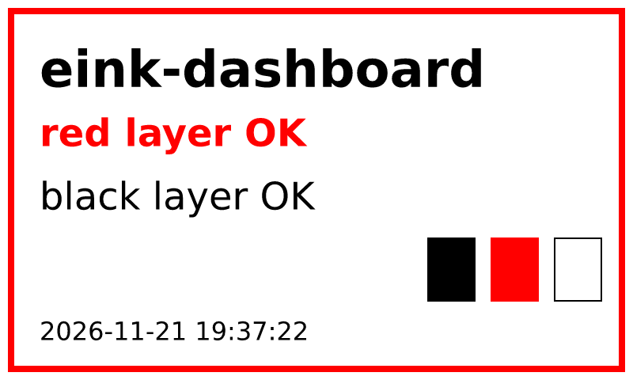

# eink-dashboard

Приложение для вывода информации на e-ink дисплей.

Это монорепозиторий: здесь собраны все части проекта.

## Структура

| Каталог | Описание |
|---|---|
| [`eink-dashboard-server`](eink-dashboard-server) | Сервер на Java (Spring Boot) |
| [`eink-dashboard-python-client`](eink-dashboard-python-client) | Клиент на Python для Raspberry Pi |
| [`design`](design) | Макеты всех экранов 800×480 (figcraft) и их PNG-превью |

Позже могут появиться другие компоненты.

## Сервер

Нужен JDK 27. Maven ставить не нужно: используется Maven Wrapper.

```sh
cd eink-dashboard-server
./mvnw spring-boot:run
```

## Макеты экранов

**Перед тем как делать экран, прочитай [правила построения экранов](design/SCREEN-RULES.md)**: дисплей трёхцветный, без полутонов, и обычная вёрстка на нём становится нечитаемой.

Каждый экран, который выводится на дисплей, сначала рисуется в [figcraft](design/screens.figcraft): один фрейм 800×480 на экран.
Цвета берутся только из стилей `eink/black`, `eink/white`, `eink/red`, это вся палитра дисплея.

После изменений фрейм экспортируется в PNG в [`design/preview/`](design/preview) (`.figcraft` — бинарный zip, на GitHub его не посмотреть).
PNG служит эталоном: с ним сравниваем то, что отдаёт сервер на `/frame`.

Шрифт макетов — DejaVu Sans, как на Raspberry Pi. На Mac: `brew install --cask font-dejavu`.

figcraft подключается к Claude Code как MCP-сервер через [`.mcp.json`](.mcp.json). Путь к CLI берётся из переменной `FIGCRAFT_CLI`, а если она не задана — `figcraft-cli` из `PATH`:

```sh
export FIGCRAFT_CLI="$HOME/figcraft-mcp/figcraft-cli"   # в ~/.zshrc
```

| Экран | Превью |
|---|---|
| `test-display` |  |
